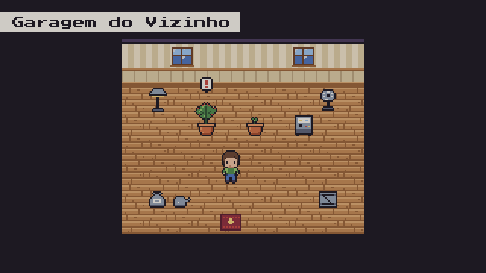
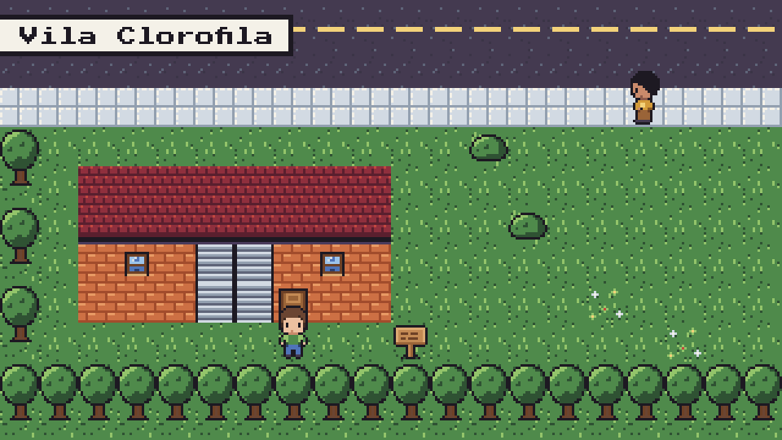
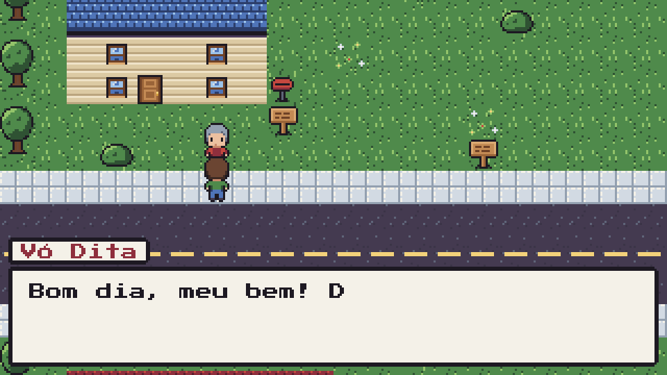

# Greenhood

RPG de cima em pixel art (estilo portátil dos anos 2000) com gestão, risco e camada social.
Comece com uma garagem e duas sementes e vire o maior império verde do servidor.

Design completo: [`docs/GDD.md`](docs/GDD.md).





## Como rodar

1. Instale o [Godot 4.3+](https://godotengine.org/download) (versão padrão, sem .NET).
2. Abra o Godot, clique em **Importar** e escolha o `project.godot` desta pasta.
3. Aperte **F5**.

| Ação | Teclado | Controle |
|---|---|---|
| Andar | Setas ou WASD | Direcional / analógico |
| Interagir / avançar diálogo | Z, Espaço ou Enter | A |
| Correr / acelerar texto | X ou Shift | B |

Um toque rápido numa direção só vira o personagem; segurar faz andar.

## Testes

```sh
godot --headless --import                    # só na primeira vez
godot --headless res://tests/test_m0.tscn    # sai com código 0 se tudo passar
```

Os testes conferem os mapas (largura das linhas, legenda, portais, traduções), se toda fala cabe
na caixa de diálogo em todos os idiomas e um percurso completo: interagir com o vaso, sair da
garagem, esbarrar na árvore, conversar com a Vó Dita e voltar para dentro.

## Estrutura

```
project.godot          320×180 ampliado em escala inteira, pixels nítidos
scenes/main.tscn       cena principal (monta mundo, câmera e interface em main.gd)
scripts/
  game.gd              autoload "Game": dados, entrada, atalhos (say, warp)
  game_map.gd          monta um mapa a partir do JSON (TileMapLayer + entidades com ordenação por Y)
  actor.gd             movimento em grade e animação (base de jogador e NPC)
  player.gd            controles, interação, portas
  npc.gd               fala e passeio aleatório
  prop.gd              vasos, equipamentos, placas, portas trancadas
  dialog_box.gd        caixa de diálogo letra por letra
data/
  tiles.json           legenda: caractere do mapa → tile, colisão
  maps/*.json          mapas: chão em texto, portais e objetos
i18n/strings.csv       todos os textos (pt_BR, en, es)
assets/sprites/        arte (avatar, objetos e quarto vêm do Pixelwright)
assets/fonts/          Press Start 2P (licença OFL)
tools/                 gerador dos tiles provisórios da cidade e das cores dos NPCs
```

### Como criar ou editar um mapa

Cada mapa é um JSON em `data/maps/`. O chão é uma lista de linhas de texto, um caractere por tile
(veja a legenda em `data/tiles.json`). Portais (`warps`) levam a outro mapa: sem `dir` disparam ao
pisar na célula; com `dir` disparam ao andar naquela direção a partir da célula (ex.: capacho).
Objetos: `npc`, `prop` (desenhado), `inspect` (invisível, responde à ação) e `door` (invisível,
fala ao esbarrar).

## Arte

- Avatar, vaso, plantas, equipamentos, piso e parede: projeto **"El Cartel – Quarto"** no Pixelwright.
- Tiles da cidade e cores dos NPCs: **provisórios**, gerados por `tools/gen_city_tiles.py` na mesma
  paleta. Serão trocados pela arte definitiva do Pixelwright.

## Roteiro

- [x] **M0 – Base**: andar em grade, colisão, portas, diálogo, garagem e Vila Clorofila
- [ ] **M1 – Loop solo**: cultivo, estoque, Growshop, venda com risco, lavagem, Paranoia, save local
- [ ] M2 – Cidade · M3 – Online · M4 – Social · M5 – Competição · M6 – Polimento
