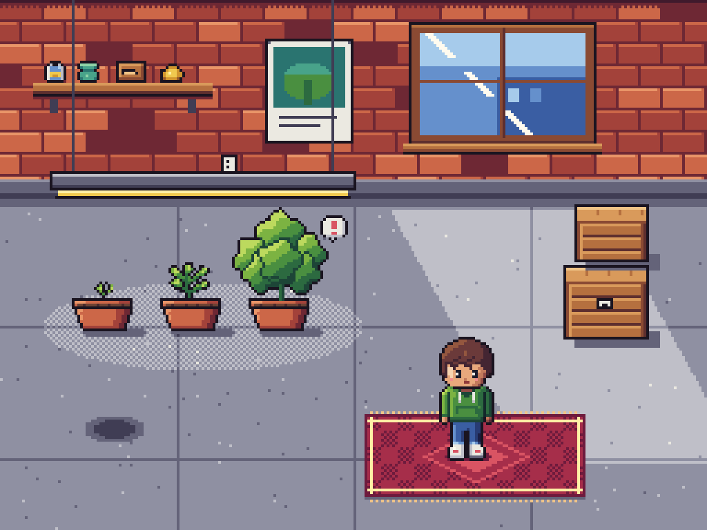
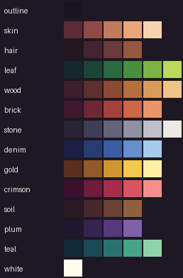
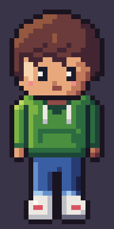
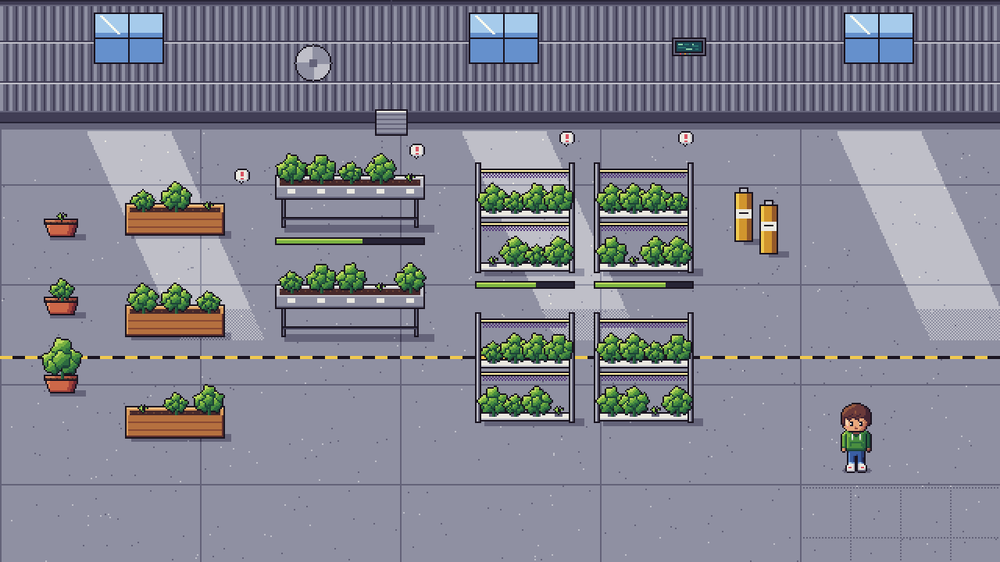
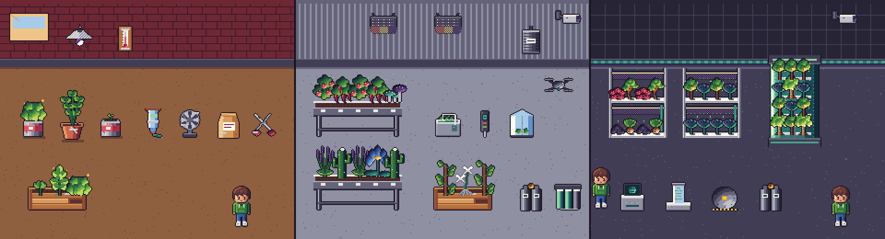
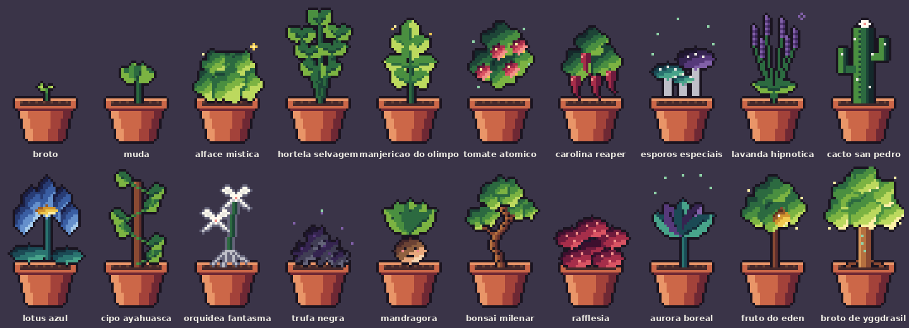
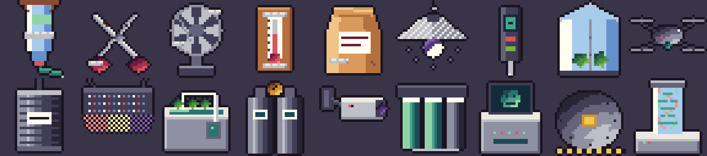

# Greenhood — Direção de Arte

> Substitui a §11 do GDD. A arte do protótipo `el-cartel` (16 px, estilo GBA) fica só como referência.
> Projeto no Pixelwright: **"Greenhood – Direção de Arte"**
> (https://studio.pixelwright.app/?cloud=prj_6aae7707656ed88d).

## 1. Pilares visuais

1. **Pixel art detalhada, não retrô cru.** Escala dobrada em relação ao GBA: mais pixels para
   rosto, roupa, textura de material e luz.
2. **Aconchegante com um fundo de perigo.** Cores quentes, luz do dia entrando pela janela e
   plantas vivas. O risco (polícia, noite, Paranoia) entra com cor fria e roxa.
3. **Leitura antes de tudo.** O personagem e os objetos interativos sempre têm mais contraste
   que o cenário.
4. **Humor visual.** Plantas "inofensivas" exageradas (Alface Mística, Fruto do Éden), placas e
   pôsteres com piadas.

## 2. Escala e câmera

| Item | Antes (M0) | Agora |
|---|---|---|
| Resolução base | 320×180 | **640×360** (ampliada em escala inteira: 2× = 720p, 3× = 1080p, 6× = 4K) |
| Tile | 16×16 | **32×32** |
| Personagem | 16×24 (cabeção) | **48×48 de canvas**, figura de ~45 px (cerca de 2,4 cabeças) |
| Campo de visão | 20×11 tiles | 20×11 tiles (o mesmo enquadramento, com o dobro de detalhe) |

- Visão **3/4 de cima** (top-down): paredes mostram a face da frente; móveis e caixotes mostram
  o tampo e a frente.
- O personagem ocupa 1 tile de largura e anda na grade de 32 px. Os pés ficam na linha de baixo
  do tile e a cabeça sobe por cima do tile de cima (ordenação por Y).

## 3. Paleta

- **62 cores em 13 rampas** (está no projeto do Pixelwright). Toda arte usa só essas cores.
- **Contorno:** `#1a1420`, um roxo quase preto. Nunca preto puro.
- **Sombras puxam para o roxo/frio, luzes puxam para o amarelo/quente.** Ex.: na pele, o laranja
  desce para vinho; no verde, o amarelado desce para verde-azulado.
- **Rampas por material:** pele, cabelo, folha, madeira, tijolo, pedra/concreto, jeans, ouro,
  carmim (tecidos e alertas), terra, ameixa (noite e UI), verde-água (dinheiro limpo, tecnologia).
- **Cores com significado no jogo:**
  - 💵 Grana suja → `gold` · 💳 grana limpa → `teal`
  - 👁️ Paranoia e polícia → `crimson` e `plum`
  - ⚡ Estamina → `gold.3` / `gold.4`

## 4. Luz e sombra

- **Luz única vinda de cima, à esquerda.** Vale em todo sprite, tile e cena.
- Lado esquerdo e topo em tons claros; lado direito e base em tons escuros.
- **Sombra de contato:** uma elipse escura sob personagens e objetos.
- **Sombras projetadas** vão para baixo e para a direita, com borda dura.
- **Luzes de cena** (janela, luminária, poste): um feixe de 1–2 tons mais claros no chão. Use
  pontilhado 50% só na borda do feixe.
- **Noite** (ciclo dia/noite do GDD): a cena inteira desce um tom e puxa para `plum`; as luzes
  ficam quentes e amarelas.

## 5. Contorno e pixels

- Contorno de 1 px na silhueta. Linhas internas usam o tom mais escuro do material vizinho, não
  o contorno.
- Materiais com volume têm pelo menos 2 px de espessura. A linha de 1 px fica para fios, cordões
  e hastes.
- Sem anti-aliasing na borda de fora. Por dentro, só a partir de 32 px em curvas longas.
- Nada de pixel solto (orphan), escadinha irregular ou duas faixas de tons paralelas
  (banding). O `project_audit` do Pixelwright confere tudo isso.

## 6. Personagens

- **Canvas de 48×48**: cabeça de ~18 px, olhos 2×3 com brilho, boca de 2 px, bochecha rosada.
- **Montados como rig** no Pixelwright (partes: sombra, pernas, tronco, braços, cabeça, cabelo,
  olhos, boca). Desenha-se uma vez e anima-se movendo as partes.
- **Variantes** de olhos (aberto, semicerrado, fechado, feliz) e boca (neutra, sorriso,
  aberta, falando), para diálogos expressivos.
- **Direções:** frente (S), costas (N) e perfil (E). O perfil esquerdo (W) é o direito espelhado.
- **Animações mínimas:** `idle` (respira e pisca), `walk` (4 quadros de 130 ms) e `talk`.
- **Silhueta com assinatura:** cada NPC tem uma forma que o identifica de longe (o coque da Vó,
  o boné do Zé, o avental do vendedor).
- **Personalização** do avatar por troca de rampa: pele, cabelo, camisa e calça trocam de rampa
  sem redesenhar.

### Protagonista
Moletom verde com capuz, cordões e bolso canguru; jeans com barra dobrada; tênis branco com
detalhe carmim; cabelo castanho bagunçado com franja. O verde é a cor do jogo e o liga à marca.

## 7. Cenários e tiles

- **Tiles de 32×32.** Os tiles que se repetem (chão, grama, calçada) precisam emendar sem
  costura. Use textura implícita: poucas manchas, nunca ruído em tudo.
- **Paredes internas** com 2 tiles de altura (64 px) e rodapé. Janelas, pôsteres e prateleiras
  são objetos por cima.
- **Exterior:** cada prédio tem uma cor de fachada e um elemento que o identifica (toldo do
  Growshop, letreiro neon do Bar do Zé, grade da Lavanderia).
- **Objetos interativos** (vasos, equipamentos, NPCs) têm mais contraste e saturação que o fundo.
  O jogador acha o que pode usar sem tutorial.

### Vasos e plantas
- Vaso de barro de 22×12 com terra visível.
- **3 estágios:** broto, muda e planta adulta. A adulta é feita de moitas redondas iluminadas da
  esquerda.
- Balão "!" quando a planta está pronta, à direita da planta.
- Cada semente do catálogo tem uma planta adulta própria (forma e cor diferentes), partindo
  desse vaso.

### Módulos de cultivo (escala do fim de jogo)

O mockup acima tem 54 plantas numa única tela de 640×360, sem zoom: 3 vasos, 3 floreiras,
2 bancadas e 4 racks hidropônicos.
- **Plantas dos módulos** usam versões menores da planta adulta (cerca de 60% do tamanho), para
  caber de 3 a 5 por módulo.
- **Vaso:** 1 planta grande. **Floreira:** 3. **Bancada:** 5. **Rack:** 8 em 2 andares com LED.
- Balão "!" e barra de progresso por módulo, não por planta.
- Equipamentos ficam em pontos fixos do cenário e não competem com os módulos pelo chão.

## 7b. Progressão visual: da gambiarra à alta tecnologia

O visual conta a história do jogador. **No começo tudo é improvisado; com dinheiro, tudo fica
profissional; no fim, é ficção científica.**

| Fase | Imóveis | Visual | Recipientes | Exemplos de equipamento |
|---|---|---|---|---|
| **Gambiarra** | Armário, Garagem, Porão | Fita silver tape, papel alumínio, madeira de caixote, ferrugem, coisas tortas e amassadas | Lata de tinta reaproveitada, vaso rachado com fita, floreira de pallet com tábua quebrada | Regador de garrafa PET, ventilador com grade torta, termômetro preso numa tábua, adubo em saco rasgado escrito à mão, lâmpada com refletor de alumínio |
| **Profissional** | Container, Sobrado, Galpão, Sítio | Metal escovado, plástico, cores neutras, organizado | Vaso de barro novo, bancada de cultivo | Medidor de pH, mini estufa, drone, filtro de carbono, painel LED, hidropônico, CO2, câmeras |
| **Alta tecnologia** | Fazenda, Ilha, Mina, Bunker | Escuro, luzes verde-água e roxas, vidro, brilho | Rack hidropônico, torre de vidro | Osmose reversa, Controlador IA (com rosto), porta de bunker, laboratório de DNA |

Regras:
- **Gambiarra sempre tem uma "marca"**: um pedaço de fita, um amassado, uma lasca, um prego torto
  ou uma emenda no fio. Nunca é só "sujo".
- **Os equipamentos do começo** usam rampas quentes (madeira, terra, barro) e prata de fita.
  **Os do fim** usam `teal`, `plum` e `stone` escuro, com 1–2 pixels de brilho.

## 7c. Catálogo de sprites (v2)

| Arquivo (`assets/sprites/v2/`) | Célula | Conteúdo |
|---|---|---|
| `plantas.png` | 32×40 | broto, muda e as 18 plantas adultas (uma por semente, na ordem do catálogo) |
| `plantas_compactas.png` | 32×40 | as mesmas a 62%, para racks e torres |
| `vasos.png` | 32×24 | lata de tinta, vaso rachado, vaso de barro |
| `equipamentos.png` | 32×32 | os 18 equipamentos, na ordem de preço |
| `floreira_caixote.png`, `bancada.png`, `rack_hidroponico.png`, `torre_vertical.png` | — | módulos |
| `index.json` | — | nomes de cada quadro e pontos de encaixe |

- **Encaixe:** a base do caule da planta fica no pixel (16, 39) da célula. Ela se apoia na
  terra do vaso (linha 5 do vaso) ou na bandeja do módulo.
- Tudo é gerado por `tools/arte/*.py` (`python3 tools/arte/build.py`), na paleta do projeto.
  Vasos, equipamentos e plantas também estão no Pixelwright para retoque à mão.
- **A retocar à mão:** as versões compactas da orquídea, dos esporos e da mandrágora perdem
  detalhe na redução. Também falta tirar o degradê em faixas das moitas maiores.

## 7d. Cenários dos imóveis

- Cada imóvel tem um cômodo com **tamanho próprio** (16:9): o Quartinho tem 240×135 e aparece mais de perto; os
  imóveis grandes chegam a 320×180 ou mais. Plantas, vasos e cenário ficam **sempre na mesma escala de pixel**
  (nada de ampliar 2× só a planta, que dá "mixels").
- Os cenários são PNGs gerados por `tools/arte/cenarios.py`: luz da janela ou da lâmpada, sombra de contato,
  oclusão nos cantos, veio de madeira e textura. Luz e sombra trocam a cor pelo degrau vizinho da mesma rampa.
- Os 14 imóveis estão com o acabamento novo (`docs/arte/cenarios-imoveis.png`). Animações por cima do PNG
  (goteira, fogo, ondas, tocha, lampiões, brilho do ouro, sirene, estrelas) e escuridão com focos de luz no
  Armário, no Porão e na Mina. Tamanhos: 240×135 (Quartinho, Armário, Garagem), 320×180 (do Porão à Fazenda)
  e 384×216 (Ilha, Mina, Bunker).

## 8. Interface

- **Fonte pixel** de altura 8 (a Press Start 2P serve por enquanto). Avaliar uma fonte mais
  estreita para os diálogos longos.
- **Caixas** com fundo `white`, borda dupla (`outline` + `stone.3`) e cantos arredondados de 2 px.
- **Ícones de 16×16** (ícones de item são a única coisa que fica em 16 px) com a mesma luz e o
  mesmo contorno.

## 9. Produção

| Lote | Conteúdo | Status |
|---|---|---|
| 0 – Guia de estilo | Paleta, protagonista (frente + idle + walk), mockup da garagem | ✅ |
| 1 – Protagonista completo | Costas e perfil, walk nas 3 direções, talk | a fazer |
| 2 – Garagem jogável | Tileset interior (piso, parede, rodapé, janela), vasos, 3 estágios, equipamentos | a fazer |
| 2b – Módulos | Floreira de caixote, bancada, rack hidropônico, torre; plantas compactas | ✅ (1ª versão) |
| 2c – Plantas e equipamentos | 18 plantas + broto/muda, 18 equipamentos, 3 vasos (da gambiarra ao high-tech) | ✅ (1ª versão) |
| 3 – Vila Clorofila | Tileset exterior (grama, calçada, rua, árvores), fachadas da Avó, Growshop e garagem | a fazer |
| 4 – NPCs | Vó Dita, Zé e Vendedor (rig com variações de rampa + acessório próprio) | a fazer |
| 5 – UI | Caixa de diálogo, HUD, ícones dos recursos | a fazer |

Exportação: Pixelwright → **Godot 4** (SpriteFrames para personagens, TileSet para cenários).

## Cômodos vistos de cima (versão atual)

`python3 tools/arte/comodos.py` desenha os 13 esconderijos em `assets/sprites/v2/comodos/`. Todos usam
uma tela fixa de 320×180: o cômodo flutua no preto com contorno escuro e cresce a cada imóvel, do
Quartinho (140×112) ao Bunker (312×170). Imagem de todos no jogo: `docs/arte/comodos-no-jogo.png`.

Cada cômodo tem três camadas:
- `NN.png`: o fundo já iluminado, com móveis, sombras projetadas, luz de borda e oclusão.
- `NN_s.png`: o mesmo fundo um degrau mais escuro. O jogo recorta dele a sombra de cada vaso.
- `NN_l.png`: o mapa de luz (degraus −2 a +1 por pixel). O jogo acende ou escurece cada planta
  conforme o lugar onde ela está, e acende a borda virada para a luz principal.

Mais `meta.json` (área dos vasos, luz principal, animações) e `shift.json` (degrau acima e abaixo de
cada cor da paleta). Assim uma planta perto da lâmpada brilha e a do canto fica na penumbra, mesmo
crescendo em tempo real. Os cenários de vista lateral (`cenarios.py`) ficam como referência.

**Vasos e calhas.** Nos 5 primeiros esconderijos (gambiarra) as plantas ficam em vasos. Do Terreno em
diante ficam em calhas de hidroponia, com um copinho de rede por planta: PVC branco nos lugares
profissionais, calha escura com LED verde nos high-tech. As calhas são desenhadas pelo jogo e recebem a
mesma luz e sombra dos vasos. A Praia tem uma palmeira só (`tools/arte/palmeira.py`), com tronco curvo
de anéis e folhas serrilhadas que caem.

**Equipamentos na cena.** Cada um tem o seu jeito de aparecer, em vez de ficarem lado a lado no chão:
garrafa PET e medidor de pH enfiados no vaso (inclinados); tesoura podando a planta mais crescida, com
pedacinhos verdes caindo; ventilador no chão virado para as plantas, mexendo a cabeça e soprando vento;
termômetro pequeno na parede; sacos de adubo empilhados (um por nível); filtro de carbono com duto até uma
grade na parede (ou só a saída de ar quando a parede é vidro ou mar); CO2 ao lado do filtro, ligado por
uma mangueira e soltando gás; painel LED como barra roxa pendurada com brilho sobre as plantas; câmera no
canto varrendo a sala; drone voando; controlador IA com rosto na tela que pisca, olha para as plantas e
sorri quando tem planta pronta ou na colheita; laboratório de genética ao lado da IA, com bolhas no tubo.
Lâmpada com alumínio, mini estufa, osmose e kit bunker não aparecem (só dão o bônus). O gerador dos
cômodos compara a parede antes e depois dos enfeites (`wallBusy` no `meta.json`), para nada ser
pendurado em cima de janela, pôster ou prateleira.