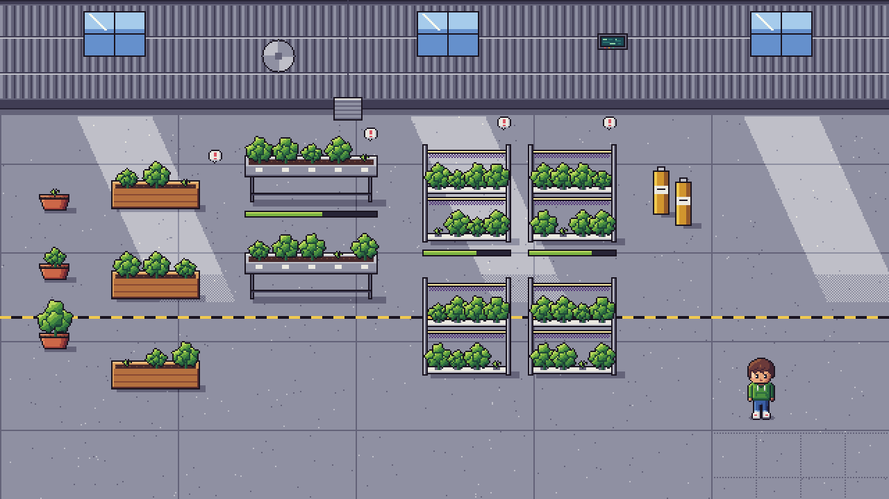

# Greenhood — Documento de Design do Jogo (GDD)

> Ponto de partida para recriar o jogo **do zero**, como jogo nativo (PC primeiro, celular depois),
> **sem** o layout de site do protótipo web `el-cartel`.
> Visual: RPG de cima em pixel art no estilo da era Game Boy Advance.
> Camada social: estilo Habbo (quartos decoráveis, salas públicas, chat em balão).
>
> Tudo o que está marcado como **[protótipo]** já existia no `el-cartel` (números tirados do código).
> O que está marcado como **[novo]** é sugestão para a versão RPG.
>
> **Originalidade:** o estilo é inspirado no gênero (RPGs de GBA), mas toda arte, música,
> personagens e mapas são próprios. Nada de tiles, sprites ou nomes de Pokémon/Habbo.

---

## 1. Visão geral

| Item | Definição |
|---|---|
| Nome | **Greenhood** (provisório até checar marca/domínio) |
| Cidade inicial | **Vila Clorofila** |
| Gênero | RPG de exploração vista de cima + gestão/idle + social online |
| Fantasia | Começar do nada (uma garagem e duas sementes) e virar o maior "cartel verde" do servidor |
| Plataformas | PC (Windows, macOS, Linux) → Android/iOS |
| Câmera | De cima, grade de 16×16 px, movimento em 4 direções |
| Sessão típica | 5–20 min: plantar, sair pela cidade, vender, lavar, voltar e colher |
| Modo | Online (servidores regionais) com o quarto/esconderijo como base pessoal |

### Pilares
1. **Andar pelo mundo em vez de clicar em menus.** Cada tela do site vira um lugar: lojas, ruas, NPCs.
2. **Risco x recompensa.** Vender mais rende mais, mas a Paranoia sobe e a polícia pode levar tudo.
3. **Tempo real.** Plantas crescem e dinheiro é lavado mesmo com o jogo fechado.
4. **Social.** Seu esconderijo é seu quarto: decore, receba visitas, converse, forme um Cartel.

---

## 2. Tecnologia recomendada

| Área | Escolha | Por quê |
|---|---|---|
| Engine | **Godot 4** (GDScript) | Gratuita, ótima para 2D pixel art, exporta para PC e celular, TileMap nativo |
| Resolução base | 320×180 (ou 240×160, a do GBA) ampliada em escala inteira | Pixels nítidos, sem borrão |
| Mapas | TileMap do Godot (ou Tiled → Godot) | Cidade e interiores em camadas: chão, objetos, colisão, portas |
| Arte | **Pixelwright** (exporta direto para Godot: SpriteFrames e TileSet) | Os sprites do quarto já existem lá (ver §11) |
| Online | Servidor **autoritativo**: Godot headless, ou Nakama, ou Colyseus | O cliente nunca decide dinheiro, colheita ou admin (ver §13) |
| Banco de dados | PostgreSQL (ou o Nakama Storage) | Saves, inventários, ranking, histórico |
| Login | Google + conta própria | Já existia login Google no protótipo |

---

## 3. Personagem do jogador

### Recursos [protótipo]
| Recurso | Faixa | Para que serve |
|---|---|---|
| Estamina ⚡ | 0–100 | Gasta ao plantar e treinar; regenera +1 por minuto |
| Paranoia 👁️ | 0–100 | Risco policial; em 100 a polícia apreende tudo |
| Grana Suja 💵 | ≥ 0 | Vem das vendas; compra sementes |
| Grana Limpa 💳 | ≥ 0 | Vem da lavagem; compra equipamentos, imóveis e serviços |
| Respeito ⭐ | ≥ 0 | Pontuação e nível |
| Nível | — | `máx(1, piso(√(respeito / 5)))` |

### Atributos [protótipo] (começam em 1)
| Atributo | Efeito |
|---|---|
| **Botânica** | +2% de produção por ponto; crescimento mais rápido (`tempo = base / (1 + botânica × 0,05)`, mínimo 5 s); libera sementes |
| **Segurança** | Treinado na Academia (reservado para defesa contra batidas, ver §8) |
| **Lábia** | +2% no preço de venda por ponto; libera métodos de lavagem |
| **Furtividade** | Reduz a chance de flagrante na venda (−0,05 ponto percentual por ponto) |

### Visual [protótipo + novo]
- Avatar personalizável: pele, cabelo, camisa e calça (já funciona por troca de cores no sprite).
- **[novo]** Roupas, chapéus e acessórios vendidos ou ganhos em eventos (cosméticos, sem vantagem).

---

## 4. Loop principal

```
 Growshop ──compra semente (grana suja)──▶ Esconderijo: planta no vaso (gasta ⚡)
     ▲                                              │ espera (tempo real)
     │                                              ▼
 Imobiliária / Equipamentos ◀── grana limpa ── Colhe → Estoque (+1 Respeito)
     ▲                                              │
     │                                              ▼
 Lavanderia ◀────────── grana suja ◀──────── Vende nas ruas (escolhe o risco)
                                                    │
                                     Paranoia sobe → Spa/Fliperama para baixar
```

---

## 5. Sistemas (com os números do protótipo)

### 5.1 Cultivo [protótipo]
- O jogador começa com **2 vasos**; o número de vasos vem do melhor imóvel que ele tem.
- Plantar exige: ter a semente, Estamina suficiente, Botânica mínima, os equipamentos exigidos e um vaso livre.
- Custo de Estamina: `custo da semente × 2` se Paranoia ≥ 60 (senão ×1).
- Ao plantar: chance de **+1 Botânica** de `máx(10%, 15–20% − 2% × piso(botânica / 5))`.
- Produção na colheita: `máx(1, piso(produção_base × multiplicador))`.
  Multiplicador = `1 + soma dos bônus dos equipamentos + botânica × 0,02`.
- Colher dá **+1 Respeito**. O produto vai para o Estoque com o valor de venda da semente.
- **[novo]** No RPG cada vaso é um objeto no quarto: andar até ele e apertar o botão de ação para plantar ou colher.
  As plantas mostram 3 estágios de crescimento e um balão "!" quando estão prontas (já desenhado).

#### Módulos de cultivo [novo]
Com tiles de 32 px, um vaso por tile não escala: a Estação Espacial teria 60 vasos espalhados e
colher um por um seria tedioso. Por isso, a **capacidade do imóvel conta plantas, não vasos**, e as
plantas ficam em **módulos** que ficam mais densos conforme o jogador progride.

| Módulo | Ocupa | Plantas | Como libera |
|---|---|---|---|
| Vaso de barro | 1×1 tile | 1 | Início do jogo |
| Floreira de madeira | 2×1 | 3 | Porão Abandonado em diante |
| Bancada de cultivo | 3×1 | 5 | Container Marítimo em diante |
| Rack hidropônico (2 andares) | 2×2 | 8 | Ter o Sistema Hidropônico |
| Torre vertical / câmara (fim de jogo) | 2×3 | 16 | Ter o Lab. de Genética |

- **Interação por módulo:** apertar ação num módulo abre "Plantar em tudo / Colher tudo / Ver
  plantas". Um vaso sozinho continua com a ação direta (plantar ou colher).
- **Leitura de longe:** cada módulo mostra um balão "!" quando tem algo pronto e uma barra com
  quantas plantas estão prontas.
- **Equipamentos não ocupam o chão:** aparecem em pontos fixos de cada imóvel (ventilador na
  parede, cilindros de CO2, filtro pendurado, painel da IA). Alguns também mudam o visual dos
  módulos (LED em cima da bancada, por exemplo).
- **Automação (ideia):** o Controlador IA replanta sozinho a mesma semente ao colher. Isso
  premia o fim de jogo sem exigir 60 cliques.
- Na tabela de imóveis abaixo, a coluna "Vasos" passa a significar **plantas** (vagas).



#### Catálogo de sementes [protótipo]
| Semente | Preço | Venda | Produção | ⚡ | Botânica | Equipamentos exigidos | Tempo (s) |
|---|---|---|---|---|---|---|---|
| Alface Mística | 5 | 8 | 3 | 5 | 0 | — | 30 |
| Hortelã Selvagem | 10 | 15 | 3 | 5 | 0 | — | 35 |
| Manjericão do Olimpo | 20 | 30 | 4 | 8 | 1 | — | 45 |
| Tomate Atômico | 50 | 80 | 4 | 8 | 2 | Regador | 55 |
| Carolina Reaper | 120 | 200 | 3 | 10 | 3 | Regador, Termômetro | 60 |
| Esporos Especiais | 300 | 500 | 5 | 12 | 4 | Termômetro, Ventilador | 75 |
| Lavanda Hipnótica | 800 | 1.200 | 4 | 12 | 5 | Fertilizante, Ventilador | 90 |
| Cacto San Pedro | 2.000 | 3.500 | 2 | 15 | 6 | Medidor de pH, Termômetro | 100 |
| Lótus Azul do Nilo | 5.000 | 8.000 | 3 | 15 | 7 | Lâmpada UV, pH, Fertilizante | 120 |
| Cipó Ayahuasca | 12.000 | 25.000 | 2 | 18 | 8 | Mini Estufa, pH, Fertilizante | 150 |
| Orquídea Fantasma | 30.000 | 60.000 | 2 | 20 | 10 | Lâmpada UV, Mini Estufa, Filtro de Carbono | 180 |
| Trufa Negra Mágica | 80.000 | 150.000 | 2 | 22 | 12 | LED, Filtro de Carbono, pH | 210 |
| Mandrágora Ancestral | 200.000 | 450.000 | 1 | 25 | 14 | LED, Hidropônico, Filtro de Carbono | 240 |
| Bonsai Milenar Clone | 500.000 | 1.200.000 | 1 | 28 | 16 | Hidropônico, CO2, LED | 300 |
| Rafflesia Gigante | 1.500.000 | 4.000.000 | 1 | 30 | 18 | CO2, Osmose, LED, Filtro de Carbono | 360 |
| Aurora Boreal | 5.000.000 | 15.000.000 | 1 | 35 | 20 | Controlador IA, CO2, Osmose, LED | 420 |
| Fruto do Éden | 20.000.000 | 65.000.000 | 1 | 40 | 25 | Controlador IA, Bunker, Lab. Genética | 600 |
| Broto de Yggdrasil | 100.000.000 | 350.000.000 | 1 | 50 | 30 | Lab. Genética, Bunker, Controlador IA, Osmose | 900 |

#### Equipamentos [protótipo] (compra única, grana limpa)
| Equipamento | Preço | Bônus de produção |
|---|---|---|
| Regador Automático | 100 | +2% |
| Tesoura de Poda | 150 | +2% |
| Ventilador Silencioso | 300 | +3% |
| Termômetro Digital | 500 | +3% |
| Fertilizante "El Secreto" | 1.000 | +4% |
| Lâmpada UV Turbinada | 2.500 | +5% |
| Medidor de pH Pro | 5.000 | +4% |
| Mini Estufa Portátil | 12.000 | +5% |
| Drone de Vigilância | 25.000 | +2% |
| Filtro de Carbono | 50.000 | +6% |
| Painel LED Full Spectrum | 120.000 | +8% |
| Sistema Hidropônico | 300.000 | +10% |
| Gerador de CO2 | 800.000 | +9% |
| Câmeras 4K | 1.500.000 | +3% |
| Osmose Reversa | 4.000.000 | +8% |
| Controlador IA | 10.000.000 | +15% |
| Kit Bunker Subterrâneo | 35.000.000 | +12% |
| Lab. de Genética | 150.000.000 | +20% |

**[novo]** Cada equipamento é um móvel que aparece no esconderijo e pode ser reposicionado.

#### Imóveis [protótipo] (grana limpa) → viram mapas de esconderijo [novo]
| Imóvel | Preço | Capacidade | Vasos |
|---|---|---|---|
| Armário Grow (Stealth) | 500 | 3 | 3 |
| Garagem do Vizinho | 1.500 | 8 | 4 |
| Porão Abandonado | 4.000 | 12 | 5 |
| Terreno Abandonado | 10.000 | 15 | 6 |
| Container Marítimo | 25.000 | 25 | 8 |
| Sobrado na Favela | 75.000 | 40 | 10 |
| Galpão Industrial | 200.000 | 60 | 12 |
| Sítio na Serra | 500.000 | 80 | 14 |
| Fazenda "Paraíso Verde" | 1.500.000 | 150 | 18 |
| Ilha Privada | 5.000.000 | 300 | 24 |
| Mina de Ouro Desativada | 20.000.000 | 500 | 30 |
| Bunker Militar | 80.000.000 | 1.000 | 40 |
| Estação Espacial | 500.000.000 | 9.999 | 60 |

**[novo]** Cada imóvel é um interior próprio (mapa diferente, tamanho maior). O jogador escolhe em qual mora e pode viajar entre os que possui.

### 5.2 Venda nas ruas [protótipo]
- Só uma venda por vez, e não dá para vender durante uma atividade na cidade.
- O nível de risco é definido pela quantidade vendida:

| Nível | Quantidade máx. | Paranoia | Chance de flagrante | Bônus de preço |
|---|---|---|---|---|
| 🟢 Discreto | 5 | +5 | 0% | 0% |
| 🟡 Normal | 20 | +15 | 5% | +10% |
| 🟠 Ousado | 50 | +25 | 15% | +25% |
| 🔴 Agressivo | 100 | +40 | 30% | +50% |
| ☠️ All-In | sem limite | +60 | 50% | +100% |

- Chance final = `máx(0, chance do nível − furtividade × 0,05)`.
- Preço por unidade = `piso(valor × (1 + lábia × 0,02) × (1 + bônus do nível))`.
- Duração: de 30 s (semente mais barata) até 3 s (mais cara), em escala linear.
- **Sucesso:** grana suja, +Paranoia do nível, `+teto(qtd / 3)` Respeito, +1 Furtividade se qtd ≥ 20, +1 Lábia se qtd ≥ 50.
- **Flagrante:** perde **tudo** (dinheiro, estoque, sementes, equipamentos, imóveis; volta para a Garagem com 2 vasos), −20 ⚡, −5 Respeito, Segurança e Furtividade voltam a 1, +1 vez preso.
- **[novo]** No RPG a venda é um **ponto nas ruas** (esquina, beco, praça) onde o jogador entrega o pedido a um NPC comprador. Durante a espera, patrulhas policiais (NPCs) andam pelo mapa. Ideia: ficar fora da linha de visão delas reduz a chance de flagrante, e a Furtividade aumenta a distância segura.

### 5.3 Lavagem de dinheiro [protótipo]
| Método | Taxa | Tempo | Paranoia | Lábia mínima |
|---|---|---|---|---|
| 🧑 Laranjas | 20% | 10 min | +2 | 0 |
| 🖼️ NFTs Falsos | 35% | instantâneo | +15 | 0 |
| 📊 Consultoria Fantasma | 15% | 5 min | +5 | 10 |
| ₿ Mixer de Crypto | 25% | 3 min | +8 | 5 |

- Valor limpo = `piso(valor × (1 − taxa))`. Vários processos de lavagem podem rodar ao mesmo tempo.
- **[novo]** Cada método é um NPC ou local na Lavanderia/centro financeiro da cidade.

### 5.4 Paranoia e polícia [protótipo]
- Cai −1 por minuto; **sobe +3 por minuto se houver dívida com o agiota**.
- Paranoia ≥ 60 dobra o custo de Estamina.
- **Paranoia ≥ 100:** apreensão total (mesmo wipe do flagrante, Paranoia volta a 0, Estamina a 10).
- **Batida periódica:** a cada 5 min, se Paranoia > 80, há 50% de chance de batida (wipe, Paranoia volta a 40).
- Diminui com Spa (−50) e Fliperama (−20).
- **[novo]** Uma barra de "procurado" no HUD. Com Paranoia alta, aparecem viaturas e policiais no mapa da cidade. Sugestão: usar **Segurança** para reduzir a perda em batidas (por exemplo, manter parte do dinheiro limpo ou um equipamento).

### 5.5 Cidade e atividades [protótipo]
Todas custam grana limpa, ocupam o jogador por um tempo e só uma roda por vez.

| Local | Custo | Duração | Efeito |
|---|---|---|---|
| ☕ Café | 5 | 1 min | +30 ⚡, +15 Paranoia |
| ⚡ Energético | 15 | 2 min | +50 ⚡, +30 Paranoia |
| 🍺 Bar do Zé | 8 | 3 min | +20 ⚡, +5 Paranoia, +1 Lábia |
| 📚 Biblioteca | 3 (−10 ⚡) | 5 min | +1 Botânica |
| 🥊 Academia | 12 (−20 ⚡) | 10 min | +1 Segurança, +1 Respeito |
| 🌑 Beco Escuro | 20 (−15 ⚡) | 10 min | +2 Furtividade, +20 Paranoia |
| 🗣️ Praça do Papo | 6 (−10 ⚡) | 5 min | +2 Lábia, +1 Respeito |
| 🧖 Spa | 100 | 15 min | −50 Paranoia |
| 🕹️ Fliperama | 10 | 5 min | −20 Paranoia, +5 ⚡ |

(O custo de ⚡ também dobra com Paranoia alta.)

**[novo]** Cada local é um prédio com interior. O jogador entra, fala com o atendente e o personagem fica ali durante a atividade (ou volta depois para buscar o resultado). Minijogos opcionais podem dar bônus: no Fliperama, um jogo de verdade; na Academia, apertar o botão no ritmo.

### 5.6 Sobrevivência depois de ser preso [protótipo]
| Ação | Efeito |
|---|---|
| 🤲 Mendigar | Gasta 3–8 ⚡ (×2 com Paranoia alta), ganha $1–3 de grana suja |
| 👵 Visitar a Avó | A cada 3 min: +15 ⚡, +$5, +10 Paranoia, 30% de chance de ganhar 1 semente básica |
| 🦈 Agiota | Empresta $500, cobra $750, +30 Paranoia; enquanto houver dívida a Paranoia sobe +3/min |

**[novo]** A Avó é uma casa no bairro inicial (NPC carinhoso, ponto de cura). O Agiota é um NPC num beco; com a dívida atrasada aparecem capangas.

### 5.7 Tempo real e offline [protótipo → novo]
- Crescimento, lavagem, vendas e atividades usam **horário de início + duração** (funciona com o jogo fechado).
- O servidor é quem confere o tempo; o cliente só exibe.

---

## 6. Mundo (como cada tela do site vira mapa)

| No site | No RPG |
|---|---|
| Estufa / Quarto | **Esconderijo**: interior com vasos, equipamentos e móveis decoráveis |
| Growshop (Loja) | Loja com vendedor; menu de compra estilo RPG |
| Imobiliária | Corretor; comprar um imóvel libera um novo interior |
| Vender | Pontos de venda nas ruas com NPCs compradores e patrulhas |
| Lavanderia | Lavanderia e escritório com NPCs de cada método |
| Cidade | Bairro com Café, Bar, Biblioteca, Academia, Beco, Praça, Spa e Fliperama |
| Cartel (ranking) | **Sede do Cartel**: mural de ranking e sala do grupo |
| Avó / Agiota / Mendigar | Casa da Avó, beco do Agiota, calçada movimentada |
| (prisão) | **[novo]** Delegacia: cena curta ao ser preso; você sai na rua só com a roupa do corpo |

### Mapa inicial sugerido [novo]
```
 [Casa da Avó]   [Praça do Papo]   [Biblioteca]
      |               |                 |
 [Garagem/Esconderijo]──Rua Principal──[Growshop]──[Café]
      |               |                 |
 [Beco do Agiota] [Ponto de venda]  [Lavanderia]──[Bar do Zé]
                       |
            [Centro: Imobiliária, Spa, Academia, Fliperama, Sede do Cartel]
```

---

## 7. Camada social estilo Habbo

### Já testado no protótipo [protótipo]
- Quarto com móveis em grade, modo "mover móveis" com o layout salvo.
- Avatar com troca de cores e chat em balão (só local).
- Servidores regionais detectados pelo IP: **SA-1, NA-1, EU-1, AS-1, OC-1** (África usa EU-1).
- Ranking por servidor: top 10 por **Respeito** e por **Grana Limpa**, com total de jogadores e força da região.
- **Wipe semanal toda quarta-feira**: quem tiver mais Respeito e Grana na semana leva a coroa.

### Para a versão nova [novo]
- **Ver outros jogadores** andando na cidade e nas salas públicas (posição sincronizada, nome e balão de chat).
- **Visitar o esconderijo** de amigos (portas trancadas, só amigos, ou aberto).
- **Decoração**: móveis cosméticos (cama, sofá, estante, tapetes, plantas decorativas), sem vantagem no jogo.
- **Emotes** (acenar, dançar, sentar) e balões de chat com filtro de palavrões.
- **Trocas** entre jogadores (sementes, produtos, móveis) feitas pelo servidor, com tela de confirmação dupla.
- **Cartéis (guildas)**: criar, convidar, cargos, sede compartilhada, metas semanais e ranking de cartéis.
- **Eventos**: batida policial global, feira de sementes raras, temporadas com cosméticos.
- Ferramentas de moderação: denunciar, silenciar, banir.

---

## 8. Apresentação estilo RPG de GBA [novo]
- Caixa de diálogo embaixo da tela, texto aparecendo letra por letra, retrato opcional do NPC.
- Menu de pausa: **Mochila** (sementes, estoque, itens), **Atributos**, **Mapa**, **Cartel**, **Opções**, **Salvar/Sair**.
- Transição com tela preta ao entrar e sair de prédios.
- Andar (padrão) e correr (segurar botão; gasta ⚡ ou não, a decidir).
- Ciclo dia/noite: à noite as vendas pagam mais e há mais polícia.
- Música chiptune original por área e efeitos sonoros curtos.
- Controles: teclado/controle no PC e direcional virtual no celular.

---

## 9. Interface
- HUD mínimo: ⚡, 👁️ Paranoia, 💵 suja, 💳 limpa, nível. Fica escondido em cenas e diálogos.
- Notificações curtas no canto ("🌿 Planta pronta no Porão!").
- Diário/log com as últimas 50 ações [protótipo].
- Tutorial: o primeiro dia guiado pela Avó [novo] (substitui o modal "Como Funciona").

---

## 10. Idiomas [protótipo]
Português (padrão), inglês, espanhol, alemão, chinês e japonês. Todos os textos devem sair de arquivos de tradução desde o começo (Godot tem suporte nativo a CSV/PO).

---

## 11. Arte

> **Atualizado:** a direção de arte foi refeita do zero, com tiles de 32 px, personagem de 48 px e paleta própria de 62 cores.
> Veja [`ARTE.md`](ARTE.md). O texto abaixo descreve a arte do protótipo e fica só como histórico.

- Grade de **16×16**, personagem de **16×24**, contorno escuro `#1d1922`, poucos tons por material.
- Já desenhado no **Pixelwright** (projeto "El Cartel – Quarto", https://studio.pixelwright.app/?cloud=prj_438c8d82839a76b4):
  - Avatar: frente, costas e perfil (o lado direito é o perfil espelhado), cada um parado e com 2 passos.
  - Vaso, 3 estágios de planta, balão "!", 6 tipos de equipamento (máquina, luminária, ventilador, regador, saco, caixa).
  - Piso de tábuas (2 variações), parede listrada com rodapé, janela e capacho.
  - Paleta com tons de madeira, parede, barro, pele, folhas, céu e metal.
- Falta desenhar: tiles da cidade (rua, calçada, grama, prédios), interiores das lojas, NPCs, polícia, móveis decorativos e ícones de itens.
- O Pixelwright exporta para Godot (SpriteFrames e TileSet), então dá para levar direto para o projeto novo.

---

## 12. Ferramentas de administração [protótipo → novo]
- O protótipo tinha um painel Admin: lista de jogadores e edição dos catálogos (sementes, equipamentos, imóveis, lavagem e níveis de venda) salvos no banco.
- Versão nova: os catálogos ficam em arquivos/tabelas no **servidor** e são editáveis por um painel web separado do jogo.

---

## 13. Lições do protótipo web (evitar na versão nova)
1. **Cliente decidindo tudo.** O navegador gravava o save inteiro (dinheiro, atributos e até `isAdmin`), então qualquer um podia trapacear. → Servidor autoritativo: o cliente só envia intenções ("plantar semente X no vaso 3") e o servidor valida e aplica.
2. **Admin pelo save.** Quem tivesse `isAdmin: true` no próprio save virava admin. → Cargos só no servidor.
3. **Ranking caro.** Para contar jogadores, o protótipo baixava todos os saves do servidor. → Tabela de ranking agregada e atualizada pelo servidor.
4. **Bug de plantio.** `plantarNoSlot` usava `gainedBotanica` fora do escopo e quebrava depois de plantar (corrigido na branch `feat/quarto-isometrico`).
5. **Título da barra de status.** A barra mostrava "PORÃO ABANDONADO_TITLE" (chave de tradução faltando).
6. **Wipe total no flagrante** é punitivo demais para um jogo social. → Considere perdas parciais, seguro via Segurança ou "fiança" paga com grana limpa.

---

## 14. Roteiro de desenvolvimento sugerido
| Marco | Conteúdo | Resultado jogável |
|---|---|---|
| **M0 – Base** ✅ | Projeto Godot, personagem andando em grade, colisão, portas, caixa de diálogo | Andar do esconderijo até a rua |
| **M1 – Loop solo** | Cultivo, estoque, Growshop, venda com riscos, lavagem, Paranoia, save local | Loop econômico completo offline |
| **M2 – Cidade** | Todos os locais da §5.5, Avó, Agiota, prisão, Imobiliária com interiores | Conteúdo do protótipo inteiro como RPG |
| **M3 – Online** | Contas, servidor autoritativo, saves na nuvem, servidores regionais | Mesmo jogo, agora com progresso protegido |
| **M4 – Social** | Outros jogadores nos mapas, chat, visitas, decoração, trocas | A camada "Habbo" |
| **M5 – Competição** | Cartéis, ranking semanal, wipe de quarta, eventos | Metajogo de longo prazo |
| **M6 – Polimento** | Música, efeitos, tutorial, celular, idiomas | Lançamento |

---

## 15. Decisões em aberto
- ~~Nome do jogo e da cidade~~ → **Greenhood** e **Vila Clorofila** (checar marca, domínio e lojas antes do lançamento).
- Manter o wipe total ao ser preso ou suavizar?
- O reset semanal apaga tudo ou só o placar?
- A correria gasta Estamina?
- Monetização: só cosméticos? passe de temporada?
- Classificação etária e tom (o protótipo usa plantas "inofensivas" com humor, como Alface Mística e Fruto do Éden).
